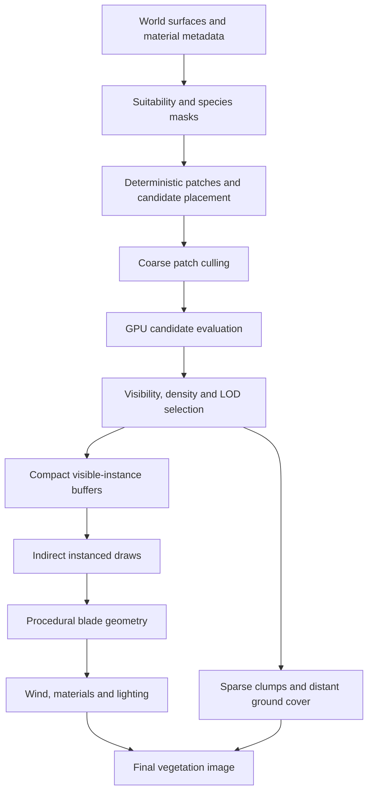

# Procedural Grass Rendering: Technical Implementation Specification

**Purpose:** Define a practical, GPU-driven system for rendering convincing grass and small ground vegetation in a real-time 3D renderer using Vulkan and GLSL.

**Audience:** Graphics programmers implementing the system without needing prior knowledge of particular games or the referenced research.

## 1. Summary and design principles

The recommended solution is a hybrid vegetation renderer with four main ideas:

1. **Generate individual curved blades near the camera.** Represent each blade with a few parameters and reconstruct its geometry on the GPU instead of storing a separate model for every blade.
2. **Generate and select vegetation in batches.** Organise the world into patches, use compute shaders to reject unsuitable or invisible candidates, and render retained instances through batched or indirect draws.
3. **Reduce detail with projected size.** Use detailed blades in the foreground, cheaper blades or clumps at medium distances, and ground-cover shading farther away.
4. **Animate from shared environmental fields.** Use a spatially coherent wind field, per-blade variation and optional local disturbances rather than simulating every blade as an independent physical object.

The result should support large vegetation fields, arbitrary 3D surfaces, stable procedural placement, believable motion and a predictable rendering cost.

Two additional principles were reinforced by building and reviewing an interactive prototype:

5. **Treat density as a coverage problem, not just a candidate-count setting.** A candidate may be the root of a small tuft containing multiple blades. Keep root spacing, the number of blades per tuft, and final blade density as separate quantities.
6. **An LOD transition must replace visual coverage, not simply remove detail.** When individual blades become cheaper clumps, the clumps must cover the same field. Reduce geometric complexity before reducing the impression of vegetation, and validate this while moving the camera as well as in a still image.

The prototype showed that a technically functioning blade renderer can still look sparse at its maximum density when a retained candidate produces only one isolated blade. It also showed that a distance cutoff can expose large bare areas even when foreground rendering looks reasonable. These are design and acceptance issues, not problems that can reliably be fixed through lighting alone.

This is a proposed synthesis of published techniques and practical prototype lessons, not a reproduction of any proprietary game implementation. The reference material at the end documents the underlying published approaches.

## 2. Goals and constraints

The system should meet these requirements:

| Requirement | Design decision |
|---|---|
| Large amounts of vegetation | Store compact patch and candidate data rather than scene objects for individual blades. |
| Procedurally generated worlds | Derive placement from surface metadata and stable random seeds. |
| Convincing close-up silhouettes | Generate curved, three-dimensional blade geometry. |
| Natural movement | Sample a shared, spatially coherent wind field. |
| Bounded rendering cost | Cull on the GPU and use multiple levels of detail (LOD). |
| Hardware flexibility | Provide a conventional compute-shader and instanced-draw path; make mesh shaders optional. |
| Multiple vegetation types | Use species profiles to configure common geometry and animation code. |
| Stable image quality | Avoid visible popping, disappearing coverage, excessive overdraw and specular shimmer. |

The first implementation should **not** create a game-engine entity, rigid body or independent simulation object for every blade. That introduces CPU, memory and simulation overhead which is unnecessary for ordinary grass.

It should not rely exclusively on transparent grass cards. A grass card is a plane containing a texture of several blades, usually with transparent pixels between them. Cards can be economical for distant vegetation, but at high densities their overlapping transparent areas can create substantial pixel overdraw. Because the whole card is often animated as one unit, the movement can also appear less natural than independently bending blades.

Nor should the renderer generate detailed geometry uniformly across the entire visible world. Blade count, geometric complexity and projected screen size should determine the work performed.

## 3. Overall architecture

Separate vegetation into three kinds of data:

- **Surface or authoring data** describes where vegetation is permitted to grow and which properties it should have.
- **Persistent placement data** describes potential vegetation in a world patch. It is generated deterministically and can be cached.
- **Per-frame data** describes which candidates are visible, the LOD selected for them and the compact instance information required to render them.

A practical pipeline is:

The baseline implementation uses compute shaders to prepare visible vegetation. They compact retained instances into GPU buffers and write indirect-draw arguments. A vertex shader reconstructs each blade from its compact parameters.

An optional advanced path uses mesh shaders to generate a whole patch of blades inside a mesh-shader workgroup. This may be attractive on supported hardware, but it is not necessary to implement the core system. Keep the placement data, species profiles and LOD policy independent of the geometry-generation path.

### 3.1 Baseline and optional paths

**Baseline path**

1. A compute shader evaluates candidates and compacts visible instances.
2. A compute pass or the same pass writes indirect-draw arguments.
3. An instanced vertex shader derives each blade's vertices from instance data and the vertex/instance IDs.
4. Fragment shading uses the generated world position, normal and material parameters.

**Optional mesh-shader path**

A mesh shader evaluates a patch and emits the required vertices and triangles directly. The design still uses the same suitability information, stable candidate identity, species profiles and LOD rules.

Start with the baseline path. Add mesh shaders only after profiling establishes a clear reason to use them and the target devices support the required Vulkan features.

## 4. Surface suitability and placement

The first requirement is to determine where grass can exist. Placement should be driven by the geometry and material properties of the world rather than by a rule that scatters vegetation over every surface.

### 4.1 Suitability data

Each potentially vegetated surface should expose some combination of:

- **Suitability:** whether vegetation is allowed to grow there.
- **Density:** how much vegetation should be present.
- **Species or type:** which vegetation profile applies.
- **Height range:** how tall vegetation should be.
- **Surface normal and slope:** whether the surface orientation is appropriate.
- **Moisture and exposure:** whether the location is wet, dry, sheltered or exposed.
- **Maintenance or degradation:** whether the location is maintained, neglected or damaged.

These values may be generated from material classifications, authored masks, world-generation rules, textures or a combination of sources. They do not need to be separate textures if the information already exists elsewhere in the engine.

Suitability should represent a probability or density weight, not necessarily a binary flag. For example, a partly suitable area can retain only a proportion of candidate blades, while a completely unsuitable area rejects all candidates.

### 4.2 Arbitrary 3D surfaces

Do not assume every surface is a flat heightmap. Support both terrain-like surfaces and arbitrary meshes.

For a terrain or heightfield, sample candidate positions in two-dimensional surface coordinates and query the surface height and normal.

For a mesh, sample the mesh's triangles. Given triangle vertices \(A\), \(B\) and \(C\), a point on the triangle is:

\[
P=(1-u-v)A+uB+vC
\]

where \(u\geq0\), \(v\geq0\) and \(u+v\leq1\).

For uniform area sampling, draw two independent uniform random values \(r_1,r_2\) and calculate:

\[
u=1-\sqrt{r_1}, \qquad v=\sqrt{r_1}(1-r_2).
\]

This produces uniformly distributed points over the triangle rather than clustering them around vertices. When sampling many triangles, select triangles in proportion to their surface area; choosing triangles uniformly would overpopulate small triangles relative to their area.

A simpler first version can allow the world generator to emit vegetation patch locations whenever it creates grass-enabled surfaces. This avoids reconstructing surface geometry at runtime and remains compatible with the broader design.

### 4.3 World tiles and patches

Partition the world into spatial tiles, each containing one or more vegetation patches. A patch is a manageable region whose vegetation can be selected, culled and rendered together. It is not an individual blade and need not correspond to one draw call.

Start by testing patch dimensions around **4–8 metres** for ordinary ground vegetation, then profile and adjust them in representative scenes. Smaller patches permit more precise culling but increase management overhead. Larger patches reduce that overhead but can cause work on vegetation that is hidden or outside the view.

Patches should align to stable world or surface coordinates, not camera coordinates. Camera-relative placement would make grass crawl when the camera moves.

Each patch should store or derive:

- A stable patch identifier and random seed.
- Surface bounds and a bounding volume.
- Suitability, density and species information.
- Candidate placement settings.
- LOD state or the information needed to derive it.
- Offsets into candidate or instance data, if those are stored explicitly.

A world tile can be subdivided into smaller rendering patches if needed for visibility selection. The patch layout and the draw-call layout should be allowed to differ.

### 4.4 Deterministic candidate generation

A jittered grid is a useful starting distribution.

1. Divide the patch into cells.
2. Derive a pseudo-random offset from each cell's integer coordinates, the patch ID and a fixed seed.
3. Place a candidate near the centre of the cell, offset by a bounded fraction of the cell size.
4. Project or sample the candidate onto the relevant surface.
5. Evaluate suitability and density to decide whether the candidate is retained.

This produces fewer obvious regular patterns than a perfectly uniform grid while remaining reproducible. The same cell must always generate the same candidate.

A deterministic hash can be built using integer-coordinate mixing operations or a small integer hash function. Its precise implementation is less important than these properties:

- The output appears sufficiently random for placement.
- Nearby cells do not repeat an obvious pattern.
- The result does not depend on frame number or iteration order.
- Different world tiles have distinct identities.

For a suitability value \(s\) and density multiplier \(d\), define a clamped retention probability such as \(p=\operatorname{clamp}(sd,0,1)\). Retain the candidate when its stable random value is less than \(p\). Avoid using a new random value every frame: that would make the vegetation flicker.

If species identifiers are stored in a texture, use point sampling or an explicit weighted choice among neighbouring samples. Do not bilinearly interpolate integer category IDs: the numerical average of two species IDs does not represent a meaningful category. A weighted neighbour choice can instead provide a less obvious transition between categories.

### 4.5 Clumps and natural variation

Independent random placement can resemble a uniformly messy lawn rather than a natural field. Real vegetation varies in groups because soil, shade, moisture and other growing conditions vary spatially.

Use a clump field to correlate parameters across a larger area than a single blade. One practical method is a two-dimensional Voronoi field:

1. Scatter deterministic seed points over the surface.
2. Jitter the seed points using a stable hash.
3. Assign any sample position to its nearest seed point.
4. Use the assigned clump ID and the distance to its seed to influence blade parameters.

The clump can control local height, density, preferred orientation, stiffness, colour and the probability of bare spots. Blades in a clump should share some characteristics but still retain per-blade variation.

Clumping can be controlled by the environment. A shaded or damp area might have different density and height from exposed ground; a maintained lawn might be comparatively uniform.

### 4.6 Separate root density from blade density

Do not assume that one retained placement candidate produces one blade. In a natural field, it is often more useful to treat a candidate as the root or centre of a small tuft, then expand it into several nearby blades. Give each blade a stable offset, height, width, lean, curvature, phase and colour variation derived from the candidate's identity and a per-blade index.

Keep these quantities conceptually separate:

- **Candidate or root density:** how often potential tufts are placed over the surface.
- **Blades per tuft:** how many individual blades are generated around a retained candidate.
- **Effective blade density:** the resulting number of blades per unit area after suitability rejection, density filtering and tuft expansion.
- **Clump coverage:** the footprint and distribution of blades within each tuft, including the space between neighbouring tufts.

This distinction matters visually and operationally. A high candidate count with one blade per candidate can look like isolated spikes. A lower candidate count with multiple overlapping blades per tuft can read as a continuous field while preserving local variation. Conversely, expanding each candidate into too many blades can create excessive overlap and render cost. Tune the first three quantities separately.

Expose density in terms that can be compared across configurations, preferably an expected effective blade count per square metre or a clearly documented density multiplier with a known baseline. A user-facing multiplier alone is insufficient unless its underlying candidate spacing, retention probability and tuft expansion are understood. Report estimated or generated blade counts in diagnostics so density settings can be related to actual geometry.

For a deterministic tuft, derive each secondary blade's offset and variation from the stable root identity plus its blade index. Do not use frame-dependent randomness. Keep the root anchored to the surface and limit the tuft radius so blades read as one coherent growth group rather than unrelated nearby plants.

## 5. Procedural blade geometry

Foreground blades should be represented by compact parameters from which their geometry can be reconstructed. This avoids storing a separate vertex mesh for every blade.

A useful representation is a **curved ribbon**: a narrow strip of triangles following the blade's centreline and tapering towards the tip. It provides a real three-dimensional silhouette while remaining inexpensive compared with fully modelled solid geometry.

### 5.1 Blade parameters

A logical blade representation can contain:

| Parameter | Purpose |
|---|---|
| Base position | Anchored position on the surface. |
| Surface normal | Establishes the local growth orientation. |
| Facing direction | Controls orientation within the surface plane. |
| Height | Controls blade length. |
| Width | Controls apparent thickness. |
| Rest bend | Controls the blade's curvature before wind or interaction. |
| Seed | Drives deterministic variation and animation phase. |
| Species index | Selects common vegetation parameters. |
| Wind response | Determines how strongly the blade bends. |
| Optional clump ID | Shares traits with nearby blades. |

Pack these values in a compact GPU structure. Not every logical parameter needs a full 32-bit float: orientations may be angles, seeds can be integers, and some characteristics can be quantised. Begin with a simple data layout, profile it, and optimise packing only when memory traffic or cache usage warrants the complexity.

### 5.2 Bézier centreline

A Bézier curve describes a smooth curve using a small number of control points. A cubic Bézier curve uses four points:

- \(P_0\): blade base.
- \(P_1\): initial direction and lower curvature.
- \(P_2\): upper curvature.
- \(P_3\): blade tip.

At parameter \(t\in[0,1]\), the centreline is:

\[
\begin{aligned}
B(t)={}&(1-t)^3P_0\\
&+3(1-t)^2tP_1\\
&+3(1-t)t^2P_2\\
&+t^3P_3.
\end{aligned}
\]

At \(t=0\), the point is the base; at \(t=1\), it is the tip. Intermediate values trace the curve.

The derivative gives the direction along the curve:

\[
\begin{aligned}
B'(t)={}&3(1-t)^2(P_1-P_0)\\
&+6(1-t)t(P_2-P_1)\\
&+3t^2(P_3-P_2).
\end{aligned}
\]

Both position and derivative are inexpensive to evaluate in GLSL. The derivative helps calculate a local direction for shading and geometry construction.

A cubic curve offers good control over rest shape and bending. A quadratic Bézier curve, with three control points, is also suitable where fewer parameters and simpler calculations are preferred.

### 5.3 Constructing the ribbon

First derive the centreline control points from the blade's parameters. The base remains anchored; the remaining points define the rest shape.

For each vertex, evaluate the centreline at a value of \(t\). Then calculate a unit vector \(S\) across the blade's width, perpendicular to its general facing direction and consistent with the local surface orientation.

Use a taper function such as:

\[
w(t)=\frac{w_0}{2}(1-t)^p
\]

where \(w_0\) is maximum blade width and \(p\) controls how quickly the blade narrows. The left and right vertices are:

\[
V_L(t)=B(t)-w(t)S
\]

\[
V_R(t)=B(t)+w(t)S.
\]

Connect consecutive pairs of left and right vertices with two triangles to form the ribbon. Check triangle winding and normals consistently.

Use enough subdivisions to represent curvature near the camera. Four or five segments are a reasonable starting point for a detailed blade; shorter or distant representations can use fewer. Geometry density should be selected by LOD rather than fixed permanently for all blades.

### 5.4 Species profiles and variation

A species profile should control:

- Minimum and maximum height.
- Width as a fraction of height.
- Default curvature and lean.
- Taper exponent.
- Number of geometric segments at each LOD.
- Stiffness and wind response.
- Colour and material properties.
- Optional interaction response.

This allows many plant types to share one renderer. Short turf, coarse weeds and longer grass can use the same geometry code with different parameter ranges.

### 5.5 Normals and double-sided shading

The curve derivative gives the local centreline direction. The blade's width vector gives its transverse direction. Their cross product produces a vector perpendicular to the ribbon; its sign depends on vertex winding.

Normalise this vector before lighting. If the ribbon is double-sided, account for back faces by flipping the normal where appropriate, or use a consistent two-sided shading rule in the fragment stage.

For thin blades, a small adjustment to the normal can broaden the apparent lighting response and make a dense field feel fuller. This is a shading adjustment only; it should not change geometry or move the root.

### 5.6 Reuse blade topology with instancing

A useful implementation pattern is to define one ribbon topology for a given segment count and reuse it for many blades. Store per-blade properties—root position, forward direction, height, width, bend, phase, stiffness and colour—as instance attributes or in a compact buffer indexed by the instance ID. The vertex shader reconstructs each blade's curve and ribbon width from that data.

This avoids duplicating identical vertex topology and per-blade values for every vertex. It also separates the cost of adding another blade from the cost of defining its shape: adding an instance adds a parameter record, while the shared ribbon defines how each blade is tessellated.

Use a higher segment count for detailed blades and a simpler topology for distant clumps. Instance data should be generated deterministically and grouped by compatible material and LOD. In a Vulkan implementation, the same logical design maps naturally to instanced draws; the instance attributes may be delivered through vertex-rate buffers or read from storage buffers, depending on the renderer's preferred layout.

Instancing does not reduce the total number of blades or fragments by itself. More instances still mean more vertices, pixel coverage and possibly shadow work. Profile effective density, geometry and overdraw separately.

## 6. GPU data flow and Vulkan integration

The CPU should manage tiles, resources and high-level rendering decisions, not process each blade individually.

### 6.1 Persistent and transient data

**Persistent data** changes only when the world or vegetation configuration changes. It includes patch definitions, candidate locations or candidate-generation seeds, species profiles and static suitability data.

**Transient frame data** changes as the camera or environment moves. It includes visible-candidate lists, selected LODs, visible-instance counts, indirect-draw arguments and any dynamic disturbance data.

Typical GPU resources include:

| Resource | Contents |
|---|---|
| Patch buffer | Bounds, surface references, seed and density settings. |
| Candidate data | Stable positions or inputs sufficient to regenerate them. |
| Suitability textures/buffers | Density, species and environmental masks. |
| Species buffer | Common parameters for each vegetation type. |
| Visible-instance buffer | Compact information for each retained blade. |
| Indirect-command buffer | Draw counts and offsets written by GPU work. |
| Wind resources | Global wind parameters and noise data. |
| Interaction resources | Optional local-disturbance data. |

These are logical resource roles. An implementation may merge or split physical buffers based on the renderer's descriptor and memory-management conventions.

### 6.2 Per-frame processing

**Stage A — Coarse patch culling.** Test each patch's bounding sphere or box against the view frustum and the maximum vegetation range. Reject patches outside those limits before evaluating their candidates.

**Stage B — Candidate evaluation.** A compute-shader invocation evaluates a candidate using its stable identity. It derives or reads the world position, samples suitability data, rejects unsuitable locations, checks visibility and chooses an LOD.

**Stage C — Instance compaction.** Retained candidates are written to a compact visible-instance buffer. A per-patch or per-batch counter records the number retained. Atomic counters can be sufficient for an initial implementation. If contention is expensive, use a prefix-sum (scan) compaction algorithm.

**Stage D — Indirect drawing.** Use the GPU-generated instance count in an indirect draw command. The vertex shader reconstructs the blade from instance data and the species profile; the fragment shader shades it.

Keep patch visibility information even when rendering multiple patches in one batch. Visibility granularity and draw-call granularity do not need to be the same.

### 6.3 Capacity, batching and memory

Do not allocate an unbounded instance buffer based on the theoretical total number of blades. Estimate the required capacity, enforce a hard limit and define a graceful fallback if it is reached. For example, discard low-priority distant candidates before nearby vegetation.

If more vegetation needs processing than fits in one batch, process tiles in groups. Double-buffering can allow one group to render while the next is prepared, provided buffers remain valid until the corresponding GPU work completes.

Avoid a separate CPU draw call for every small patch. Group compatible patches by species, material and LOD, then use indirect drawing or multi-draw indirect where suitable.

### 6.4 Vulkan synchronisation requirements

Shader-generated data must be visible to the later GPU stages that consume it. In particular:

- Compute writes to visible-instance data must be available before the vertex shader reads those buffers.
- Compute writes to indirect arguments must be available before indirect-command consumption.
- Counters must be cleared before they are incremented for a new batch.
- Buffers reused across frames must not be overwritten while prior GPU work still reads them.

Use pipeline barriers and access masks appropriate to the engine's Vulkan synchronisation model. With synchronization2, express dependencies through `vkCmdPipelineBarrier2` and the relevant memory or buffer barriers.

Test the capacity limit and synchronisation independently of visual tuning. Missing barriers, stale counters and indirect argument races can cause intermittent errors that are difficult to diagnose from screenshots.

## 7. Level of detail and distant vegetation

Level of detail (LOD) means changing an object's representation as its projected size decreases. The objective is not just to remove geometry; it is to preserve the visual impression of vegetation while doing less work.

Use several representations:

| Representation | Typical use | Rendering method |
|---|---|---|
| Detailed blades | Foreground and close inspection | Curved ribbons, several segments, per-blade variation and full wind response. |
| Simplified blades | Middle distance | Fewer segments and lower candidate density. |
| Sparse clumps or impostors | Farther distance | Larger low-cost clusters or textured representations with simple deformation. |
| Ground cover | Beyond useful geometric detail | Material colour and normal variation, with no individual blades. |

An impostor is a simplified image-based representation of geometry. A grass clump can be represented by a small number of cards or a compact geometric patch. At sufficiently long range, the base material often gives a better result than drawing subpixel blades.

### 7.1 Select LOD by projected size

Distance is an easy first approximation, but projected size provides a better estimate of how much detail matters.

For a perspective camera, the approximate projected height of a blade is:

\[
h_{px}\approx\frac{Hf_y}{z}
\]

where \(H\) is world-space height, \(z\) is view-space depth and \(f_y\) is vertical focal length expressed in pixels. For an image of height \(N\) pixels and vertical field of view \(\theta\):

\[
f_y=\frac{N}{2\tan(\theta/2)}.
\]

This is an approximation for a blade whose dimensions are small relative to its distance and which is oriented approximately across the view direction. More exact projected bounds can be used if worthwhile.

As initial tuning values, consider:

| Approximate projected blade height | Starting representation |
|---|---|
| Above 12 pixels | Full blade detail. |
| 4–12 pixels | Fewer segments and reduced density. |
| 1–4 pixels | Sparse clumps or minimal geometry. |
| Below about 1–2 pixels | Usually omit individual geometry and rely on ground cover. |

These are starting points, not universal thresholds. Adjust them for resolution, camera FOV, anti-aliasing, blade type and the importance of the vegetation to the scene.

### 7.2 Preserve apparent coverage

If density simply decreases with distance, a dense field can become sparse or bald. Two techniques help preserve its appearance.

First, widen surviving blades modestly as their number decreases. This compensates for removed coverage; it is not meant to imply that the plants physically change size.

Second, transition gradually between representations. Stable world-space randomness can determine which candidates belong to which representation during a dithered cross-fade. Do not change the random seed when selecting another LOD, or the vegetation pattern will visibly rearrange as the camera moves.

The target is stable perceived density: the ground should not appear to lose its vegetation when the camera moves backwards.

A practical failure mode is to render detailed blades near the camera and then simply disable those blades beyond a fixed distance. This can leave the far half of a patch visibly bare even though the near geometry is convincing. Treat every LOD change as a representation hand-off:

1. Ensure the incoming representation covers the same world-space area as the outgoing representation.
2. Fade or dither the two representations over a bounded transition range, using a stable world-space hash so the pattern does not crawl between frames.
3. Keep clumps or another low-cost vegetation representation available until ground-cover shading is sufficient to represent the remaining vegetation.
4. Only remove individual geometry where its projected contribution is small enough; do not use the LOD distance as a blanket coverage cutoff.
5. Inspect transitions from several camera angles and while moving the camera. An elevated overview can reveal bare regions, while a ground-level view is better for judging overlap, silhouettes and excessive gaps.

When two representations overlap during a cross-fade, use complementary fade rules or a stable dither mask to avoid a bright or dark band from double rendering. The precise fade mechanism should fit the renderer's anti-aliasing and transparency conventions.

### 7.3 Culling strategy

Implement frustum and distance culling first. They are relatively straightforward and often eliminate large amounts of work. Patch-level bounds can reject broad areas before evaluating individual blades.

Occlusion culling may be useful in some environments, but it adds work and does not always improve performance substantially for small vegetation. Add it only after profiling demonstrates that hidden vegetation is a meaningful cost. Avoid solving an unmeasured problem with a more complicated visibility system.

## 8. Wind animation

Wind is among the most important contributors to a convincing grass field. The objective is to make vegetation look as though it belongs to one environment, not to make every blade move independently at random.

### 8.1 Shared procedural wind field

Represent wind using global parameters such as horizontal direction, base speed, gust intensity, turbulence and optional location-dependent modifiers.

Evaluate the field in world space. This ensures adjacent patches sample the same field and that wind remains stable as the camera moves.

A practical field combines two layers of noise:

1. A low-frequency field produces large, slowly evolving gusts.
2. A higher-frequency field adds small variations in local movement.

Both layers should scroll in the prevailing wind direction and change continuously over time. Avoid random values that jump each frame.

A conceptual formulation is:

\[
W(P,t)=aN_1(k_1P-v_1Dt)+bN_2(k_2P-v_2Dt)
\]

where:

- \(P\) is the world-space sample position projected onto a relevant two-dimensional plane.
- \(t\) is time.
- \(D\) is the wind direction in that plane.
- \(N_1,N_2\) are continuous noise functions.
- \(k_1,k_2\) control spatial scale.
- \(v_1,v_2\) control apparent movement speed.
- \(a,b\) control the relative influence of each layer.

This is a conceptual recipe rather than a mandated noise implementation. The noise can be sampled from a texture, calculated procedurally or generated by another deterministic field system. The important properties are spatial coherence, temporal continuity and common sampling between neighbouring vegetation.

### 8.2 Apply wind to a blade

Do not translate the whole blade with the wind. Its base should remain anchored to the surface.

Use the wind sample to alter blade lean and curvature, increasing displacement from root to tip. For example, apply a small offset to the lower curve control points, a larger offset to the upper control point and the full offset to the tip. This gives smooth bending without a physical simulation for each blade.

For sloped surfaces, project the wind vector onto the surface's tangent plane before applying it. Otherwise, a world-horizontal wind vector can make blades move unnaturally into or out of roofs and slopes.

### 8.3 Avoid synchronous motion

Give each blade a stable phase offset derived from its seed and position. Use this to vary a small secondary sway at a low amplitude compared with the main gust-driven bend.

The shared field determines the main movement. Per-blade variation prevents neighbouring blades from moving in perfect synchronisation.

A small sine-based secondary motion can be added to the centreline as a function of time, phase and blade height. It should complement, not replace, the shared wind field.

### 8.4 Environment-dependent wind

A uniform global wind can look artificial in dense environments. Add optional spatial modifiers for sheltered regions, exposed ridges, corridors or other environmental features.

Begin with inexpensive directional and strength fields. A physically detailed fluid simulation is a separate subsystem and is not required for convincing grass animation.

## 9. Local interaction and recovery

The system can support vegetation reacting to nearby moving objects without requiring physical simulation of every blade. Examples include grass bending as a character passes through it, vegetation moving when an object brushes past, or plants being pushed aside locally.

### 9.1 Local disturbance field

Represent each moving object as a local influence with position, radius, direction and strength. A blade evaluates whether it lies within the influence radius and applies a smooth, distance-dependent displacement.

One useful radial falloff is:

\[
q(r)=\begin{cases}
(1-r^2)^2,&0\leq r<1\\
0,&r\geq1
\end{cases}
\]

where \(r\) is distance from the disturbance centre divided by the influence radius.

Scale the displacement by this falloff and by the vegetation type's interaction response. Direct it away from the source, optionally incorporating its direction of motion.

For a first implementation, evaluate a small list of nearby disturbances in the compute or vertex shader. Only nearby patches should evaluate a source. If many objects can interact with vegetation simultaneously, replace the list with a spatially indexed disturbance field without changing the conceptual interface.

### 9.2 Gradual recovery

Grass should not snap immediately to its rest position when an object moves away. Let the disturbance decay and the blade return gradually.

A simple damped response is:

\[
d(t)=A e^{-\lambda t}\sin(\omega t+\phi)
\]

where \(A\) is initial displacement, \(\lambda\) controls damping, \(\omega\) controls oscillation frequency and \(\phi\) is the initial phase.

This can be used to modulate local displacement without running a full spring simulation for each blade.

Keep local interaction separate from ordinary wind. Global wind is a coherent, inexpensive field; interaction work is limited to areas where it can be seen.

## 10. Materials and lighting

Procedural geometry alone does not guarantee convincing vegetation. The material must preserve blade silhouettes, establish depth at the roots and integrate with the engine's ordinary lighting.

### 10.1 Base colour and variation

Give each vegetation type a base-colour profile, then vary colour by clump rather than completely independently for every blade.

Colour can change gradually along a blade, with darker roots and lighter tips. Root darkening approximates the fact that less light reaches the base of a dense field and helps imply overlapping blades.

Use subtle patch-level colour variation to prevent a uniformly coloured carpet. Excessive per-blade random colour creates visual noise. Make colour variation coherent over a clump.

### 10.2 Thin-surface lighting

Use the blade normal for ordinary diffuse and specular lighting, with a modest backlighting term to suggest light passing through thin leaves. One approximation adds a small amount of illumination when the light is on the opposite side of a blade from the visible face, weighted by the vegetation type and blade height.

Keep this effect restrained. Grass should not glow independently of its surroundings. It is most noticeable when blades are backlit or silhouetted.

### 10.3 Wetness and specular response

In rainy environments, vegetation should share the environment's wetness system. Wetness can lower roughness, increase specular response within reasonable limits and slightly alter base colour.

Wetness should be spatially variable. Exposed blades, sheltered vegetation and grass growing in a damp depression need not use identical values.

Do not make every blade uniformly glossy. Fine moving highlights over many narrow blades can shimmer or alias, especially at a distance. Reduce fine-scale specular response as blade detail becomes subpixel and let the distant ground-cover representation take over.

Use the existing scene lighting so that coloured lights and environmental illumination naturally affect the vegetation. The grass renderer should not require its own special lighting system.

### 10.4 Anti-aliasing and temporal stability

Narrow triangles frequently occupy less than one pixel. This can produce flicker, shimmer or unstable coverage.

Use geometric LOD, stable density reduction and the engine's anti-aliasing solution together. Widening remaining blades modestly at distance can preserve coverage, but excessive widening turns grass into broad strips.

Where the renderer uses temporal anti-aliasing or temporal reconstruction, provide appropriate velocity information for moving vegetation when supported by the engine. Rapidly moving overlapping blades are challenging because surfaces that were visible in one frame may be hidden or exposed in the next.

Use the ground-cover representation when individual blade detail cannot be represented reliably at the target pixel size.

### 10.5 Integrating with the render pipeline

Integrate vegetation with the engine's existing material and rendering architecture. In a deferred renderer, decide whether vegetation writes to the ordinary G-buffer; in a forward renderer, use the established forward-material path.

Maintain consistent depth testing, material conventions and shadowing. First ensure grass receives appropriate scene illumination and shadows. Then decide whether foreground vegetation needs to cast detailed dynamic shadows of its own.

Detailed grass can be expensive in shadow passes because geometry is processed again. Begin with a conservative shadow policy and profile its cost separately from the main vegetation pass.

## 11. Performance engineering and diagnostics

Blade count alone is not a useful performance metric. Rendering can become expensive for several different reasons:

- Candidate evaluation and suitability-mask sampling.
- Visible-instance compaction and buffer traffic.
- Geometry generation and vertex processing.
- Pixel shading and overlapping geometry (overdraw).
- Shadow rendering.
- Synchronisation or draw-submission overhead.

Measure these costs separately. Reducing density will not solve a problem caused primarily by expensive shadow passes or excessive draw-command overhead.

### 11.1 Diagnostic views

Provide debug views that distinguish placement problems from geometry or material problems:

- **Suitability:** show where vegetation is allowed.
- **Density:** show target root/candidate density, effective blade density and any reductions from suitability or LOD.
- **Species:** colour patches by vegetation type.
- **Clumping:** show procedural clump boundaries or IDs, including representative tuft footprints.
- **LOD:** assign a debug colour to each representation.
- **Wind:** visualise sampled direction and strength.
- **Culling:** display accepted and rejected patches or candidates.
- **Shading:** isolate base colour, normals, roughness and wetness.

These views make it easier to diagnose patchy coverage, LOD popping, inconsistent wind and unexpectedly high GPU cost.

### 11.2 Measurements

For representative scenes, record GPU time for the vegetation-preparation compute pass, main grass render pass and vegetation shadow pass separately.

Also record candidate counts, retained root counts, effective blade counts, blades per tuft, triangle counts, draw-command counts and patch counts by LOD. Distinguish theoretical candidates from blades actually generated after suitability filtering and tuft expansion. Establish a measurable baseline before adding more sophisticated optimisations, then tune against a defined frame-time budget.

Do not judge success from a single still image. Camera movement, changing wind, specular response and local interaction can reveal problems that are invisible in a static frame. Use both an elevated overview and a low camera angle near blade height: the former reveals global coverage and bare patches, while the latter reveals silhouette quality, overlap and whether each tuft reads as grass rather than isolated spikes.

## 12. Implementation sequence

Implement the system incrementally so each stage can be tested independently.

1. **Surface suitability and placement.** Implement vegetation-enabled surfaces, patch generation, stable random placement and species parameters. Render simple static ribbons to validate distribution and surface alignment. Count retained candidates and estimate effective blade density.
2. **Tufts and procedural curved blades.** Add deterministic multi-blade tufts with correlated but varied height, width, lean and colour. Add Bézier blades, tapering and normals. Reuse shared ribbon topology through instancing. Validate both a close, ground-level view and an elevated coverage view.
3. **GPU visibility and instance generation.** Add patch culling, candidate evaluation, density filtering, compact visible-instance buffers and indirect instanced draws. Validate synchronisation and capacity handling before increasing density.
4. **LOD and coverage preservation.** Add simplified multi-blade clumps and ground-cover transitions. Ensure each incoming representation replaces the coverage of the outgoing representation. Use projected size and stable random values to prevent popping; do not let distance culling create large bare regions.
5. **Shared wind.** Add the coherent multi-scale field, root-anchored deformation and per-blade phase variation. Test both a stationary and moving camera.
6. **Materials and wetness.** Integrate root darkening, subtle transmission, ordinary scene lighting, wetness and distance-dependent specular response.
7. **Local interaction.** Add local disturbances and damped recovery while keeping ordinary wind inexpensive.
8. **Profiling and optimisation.** Measure each pass, then tune patch size, density, geometry and shadow policy. Consider mesh shaders only if profiling and platform requirements justify them.

This order prioritises correct placement and stable rendering before advanced geometry generation or more elaborate physical behaviour.

## 13. Acceptance criteria

The implementation is not complete merely because it renders a large number of blades. It should meet the following conditions:

| Area | Acceptance condition |
|---|---|
| Placement | Vegetation is anchored to valid surfaces and absent from prohibited materials. |
| Determinism | Regenerating the same world section with the same seed reproduces placement. |
| Geometry | Foreground blades have convincing curved silhouettes and do not resemble flat cards. |
| Natural variation | Height, orientation, density and colour vary coherently without an obvious repeating grid. Individual candidates expand into convincing tufts rather than isolated spikes. |
| Density | The configured density maps to a documented effective blade density. The highest normal-use setting produces the intended full field without requiring a separate undocumented multiplier. |
| Wind | Neighbouring patches move coherently, with individual variation and no visible seams. |
| LOD | Vegetation becomes cheaper with distance without conspicuous popping or sudden loss of coverage. Each LOD representation covers the intended vegetation footprint until ground-cover shading can take over. |
| Visual review | Both close-to-ground and elevated overview views are available for evaluating silhouette/overlap and whole-field coverage respectively. |
| Lighting | Roots appear embedded in the surface, and wetness and illumination match the rest of the scene. |
| Performance | Preparation, rendering and shadow costs are independently measurable and fit the target budget. |
| Vulkan correctness | GPU-generated counts, instance data and indirect draws work without races, stale counters or overruns. |
| Interaction | Local deformation remains spatially limited and recovers gradually without destabilising global wind. |

The initial test scene should include three contrasting cases: grass on a flat surface, vegetation on a sloped or irregular mesh, and a dense overgrown patch. Those cases exercise placement, geometry, density, lighting and LOD without requiring a complete world.

## 14. Practical lessons from the prototype

The browser prototype is not a performance proxy for the final Vulkan renderer. Its CPU-side placement and browser rendering architecture differ from the proposed GPU-driven production implementation. However, it exposed several visual-design issues that apply regardless of API.

### 14.1 Do not confuse a functioning renderer with adequate visual density

The first version generated individual blades correctly, but the field still looked sparse even with the density control at its maximum. The control changed candidate retention, yet one retained candidate usually produced only one isolated blade. This made the grass read as separated spikes over a visible ground texture.

The revised version expands each retained root into a small, deterministic tuft of several blades, with stable per-blade changes to position, height, width, angle, bend, phase and stiffness. The lesson is not that every grass system must use a fixed tuft size. It is that root spacing and blades-per-root are distinct authoring parameters, and both need tuning against the desired species and field coverage.

When possible, express and display effective blade density, not just a relative multiplier. The expected result of a setting should remain understandable when candidate spacing, suitability or blades-per-tuft changes. A high maximum value is not a meaningful specification if the resulting field still looks sparse.

### 14.2 LOD must preserve the field, not only the foreground detail

The first version looked more acceptable near the camera than in the distance because the detailed representation was visible over a limited range, with no sufficiently persistent low-cost representation to preserve the field behind it. The updated version keeps a simpler clump representation across the field and fades detailed blades to clumps over a transition range. The field looks fuller because LOD changes how the vegetation is represented rather than creating a large area with no vegetation geometry.

For production, define the coverage contract for each LOD: which world-space area it represents, what incoming representation replaces it, how the transition is blended, and at what point ground-cover material is enough. Validate not only the centre of the patch but its far edge and the full field while orbiting or moving the camera.

### 14.3 Instance the shared ribbon and keep variation per blade

The updated prototype uses one ribbon topology for each segment count, with root, direction, height, width, bend, animation phase, stiffness and colours carried as per-instance attributes. This keeps topology storage shared and makes variation explicit. A Vulkan version can carry the same data through an instance buffer or storage buffer and reconstruct the curve in the vertex shader.

This storage choice does not make dense grass free: every additional instance still requires vertex processing and may increase fragment overdraw and shadow cost. Use instancing to avoid duplicated data, not as a reason to ignore the total geometry and pixel budget.

### 14.4 Validate in both overview and ground-level views

The elevated view revealed broad gaps between patches; the lower view made blade overlap, silhouettes and the visual density of tufts easier to judge. Both are necessary. A field that reads as dense from above can still look like sparse spikes at player height, and a convincing close-up can conceal holes across the overall patch.

Treat these as acceptance checks during implementation, alongside numeric counters and GPU timings. A prototype can confirm visual direction and interaction design, but it cannot establish the performance of Vulkan compute, indirect draws or a mesh-shader implementation. Those parts still require measurement in the target renderer.

## 15. Technical references

The specification explains the relevant algorithms directly; these references document the source approaches and provide further context where required.

1. **Klemens Jahrmann and Michael Wimmer, “Responsive Real-Time Grass Rendering for General 3D Scenes” (2017).** A peer-reviewed paper describing individual geometric blades, hardware tessellation, GPU-side culling and a per-blade physical model. A key contribution is support for grass on arbitrary 3D surfaces rather than only flat terrain or heightmaps. The design here uses its GPU-oriented principles but begins with simpler procedural wind rather than requiring a full physical simulation. [TU Wien publication page](https://www.cg.tuwien.ac.at/research/publications/2017/JAHRMANN-2017-RRTG/) · [DOI](https://doi.org/10.1145/3023368.3023380) · [Author draft PDF](https://www.cg.tuwien.ac.at/research/publications/2017/JAHRMANN-2017-RRTG/JAHRMANN-2017-RRTG-draft.pdf)

2. **Eric Wohllaib, Sucker Punch Productions, “Procedural Grass in Ghost of Tsushima” (GDC Advanced Graphics Summit, 2021).** A production account of GPU-generated individual blades, tile-based placement, suitability sampling, culling, clump variation, curved geometry, LOD and a shared wind field. It is especially relevant to separating instance generation, geometry reconstruction and shading. [GDC Vault session](https://gdcvault.com/play/1027033/Advanced-Graphics-Summit-Procedural-Grass) · [GDC video](https://www.youtube.com/watch?v=Ibe1JBF5i5Y)

3. **Stephen McAuley, Ubisoft Montreal, “Rendering the World of Far Cry 4” (GDC, 2015).** Describes a vegetation system transitioning from individually modelled leaves up close to tessellated, displaced billboards farther away, alongside vegetation animation. It supports the principle of changing representation with distance; it does not establish that every later game uses the same implementation. [GDC Vault session](https://www.gdcvault.com/play/1022234/Rendering-the-World-of-Far) · [Presentation PDF](https://media.gdcvault.com/gdc2015/presentations/McAuley_Stephen_Rendering_the_World.pdf)

4. **AMD GPUOpen, “Procedural Grass Rendering” (2024).** A practical mesh-shader implementation that explains Bézier-based blade construction, vertex and triangle generation, patch assembly, distance-based geometry reduction, blade-width compensation, wind animation and simple shading improvements. The principles apply beyond the optional mesh-shader route. [GPUOpen article](https://gpuopen.com/learn/mesh_shaders/mesh_shaders-procedural_grass_rendering/)

5. **Supplementary production context: GDC’s “Blowing from the West: Simulating Wind in Ghost of Tsushima.”** Useful for understanding shared environmental wind and how motion can communicate a coherent world direction. It is not a requirement to reproduce the game's specific wind system. [GDC Vault browse page for Ghost of Tsushima sessions](https://gdcvault.com/browse/gdc-21?keyword=blade)

## Final recommendation

Build around deterministic vegetation patches and compact blade parameters. Use compute shaders for candidate selection and visible-instance generation, conventional instanced draws for the first implementation, a shared multi-scale wind field, and progressively cheaper representations as projected detail decreases.

This architecture provides convincing close-range geometry, economical large-scale coverage, support for arbitrary surfaces and a clear path to optimisation without requiring a physical simulation for every blade or making mesh shaders a mandatory dependency.
